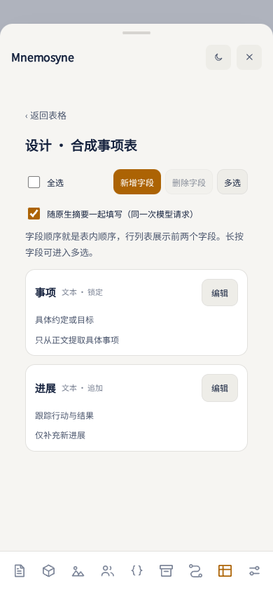
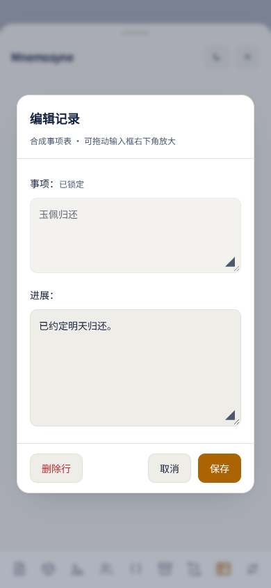

> 1.4.11：物理库仍为 DB3，核心包升级为 v14。升级前保留旧版核心包；旧插件不能读取 v14 包，不要让旧版继续写新库。原生磁盘备份需宿主提供 `__TAURITAVERN__.api.extension.store` 的六项接口，缺少时明确停用并保留手动导出。最低 TT 发布版本未据此推断；固定源码契约见 [原生备份说明](18-native-core-backups.md)。

# Mnemosyne 日用记忆使用说明

适用分支：`work/daily-memory-mvp-baibai`，1.4.2 批量人工确认与渲染减负版。状态仍为 `implemented_unverified`；合成 Node/fake IndexedDB 与组件测试、类型检查和构建的证据见[本轮回执](../notes/v1.4.2-bulk-summary-render-review.md)，实际 TT 手机验收仍待完成。

## 当前正文保存（本次开发版）

每个分支、每条消息只保留当前选中的完整正文；编辑、swipe、重新生成会更新该分支的当前内容。需要长期保留另一条剧情时，使用分支存档。另一分支仍在使用的正文不会被覆盖。

摘要、事件和表格回退历史仍保留。旧版本来源证明可能还在，但旧正文已不保存时，来源差异会明确显示“此旧版正文未保留”，不会拿新正文冒充旧文。新核心包为 v14；旧 v1–13 包仍能恢复，升级不会自动删除旧库已有正文历史。详细边界见[当前正文保存策略](17-current-body-retention.md)。

当前正文与摘要来源恢复属于不同边界；本段实现不代表已完成手机验收。

## 恢复旧包后显示“摘要基线缺失”

旧核心包可能没有宿主较新摘要当时使用的生成快照。1.4.1 会保留当前正文、摘要及原来源声明，将能与宿主证据精确对应的缺失来源标记为待人工核对；不会补造旧正文或把当前正文当成原生成证明。旧错误可能先提交摘要再报错，所以显示正文/摘要 0 不等于库为空。

更新并完整刷新后，在原受影响聊天点“刷新 / 重试归档”，不需要重新继承。归档成功后，可先导出核心包。核对各摘要及所在楼层此前的当前正文后，点“核对并保留 N 条现有摘要”→“已核对，保留这些摘要”；若 155 条均符合条件，按钮就显示 155。此批次保留原文，另存人工确认版本，不调用模型、不改宿主摘要，旧摘要和缺失生成证据继续保留。也可展开逐条处理。高层摘要、事件依赖及无法映射的条目仍单独审核，不会一起放行。

如果仍提示某条历史引用缺失，保留当前库、宿主聊天和旧包，不要反复导入或缩短前缀继承。无法匹配当前宿主证据的旧修订仍严格阻止导出，需另行核对。详细范围见[摘要来源恢复](20-summary-source-recovery.md)。

磁盘备份中，“读取备份列表”会显示读取进度、成功时间、已验证数量或具体错误。首次未读取时数量未知；“已启用”不表示已经写入。归档错误、绑定冲突或表格待处理会显示自动备份暂缓原因，处理后继续按原检查节奏检查，不绕过校验。

## 先回答“需要点知识库复制吗？”

**只有你曾在旧柏宝书导入知识库，且要继续使用这些文件时才需要点。** 正文和摘要归档不依赖它。没有旧知识库就跳过。

打开原聊天后，看到 **“已归档 · 正文 N · 摘要 M · 待审核 0”**，且没有 pending / 错误，表示这个聊天的正文和已有摘要已经进入独立的 Mnemosyne 正式数据库。不是只显示聊天里的计数。当前聊天会继续自动归档后续变化；不需要再点某个“确认迁移”按钮。

未曾归档、没有继承绑定的聊天会自动建立独立的故事与分支，直接显示已归档不代表与别的聊天共用档案。带可靠宿主父聊天标记且前缀核对成功的新分支会自动继承；来源不明确或匹配失败时仍需手动检查。档案状态下展开「当前聊天与档案标识（只读）」可查看当前聊天名及分支档案ID，切换后比较；切换等待期间会清空旧标识并显示等待归档。

首次打开大聊天，后台归档可能仍需等待；“已归档”后不会为了打开页面而重新读取所有正文和摘要。档案页不再显示全量正文/摘要，自定义表页也不加载摘要选择列表。看摘要请使用原生“摘要”页。

## 档案 / 迁移页

| 按钮或状态 | 用途 | 何时使用 / 是否调用模型 |
| --- | --- | --- |
| 已归档 | 当前聊天已写入新库，显示当前视图计数 | 平时看到即可；待审核数与归档成功是两件事 |
| pending / 可重试 | 当前宿主保存或新库同步未完成 | 阅读错误，解决后点刷新 / 重试；不需要重新导入聊天 |
| 刷新 / 重试归档 | 检查聊天变化，补交失败的归档 | 无变化时复用已完成视图；不调用模型 |
| 从旧柏宝书复制本角色知识库 | 复制当前角色的旧知识库文件和已有向量到新扩展的知识库命名空间 | 可选；不调用模型、不改旧库；同 ID 已复制的文件会跳过。旧索引不完整会提示重新导入 |
| 导出核心包 | 下载整个活动库的逻辑备份，包含全部故事和分支 | 跨设备或备份时使用；先等最新归档完成 |
| 恢复到新空库 | 验证包，写入另一空库，再切换活动库 | 不合并两端修改；失败不替换原活动库，成功也保留原库 |
| 加载待审核项（只读） | 按需读取已归档视图中的待审核摘要 | 不触发归档，不改摘要或事件，不调用模型；等待后台归档完成再读 |
| 查看来源差异 | 显示原来源楼层、首处身份/正文/角色差异及短片段 | 只读、本机对照，不自动确认兼容；高层还需检查下级版本 |
| 保留摘要 | 人工确认该摘要对当前正文版本仍适用 | 不调用模型，仅对已确认的来源和依赖版本生效；无关后续追加不撤销确认 |
| 核对并保留 N 条现有摘要 | 明确确认当前可映射 L0 恢复摘要适用于当前正文 | 不调用模型；弹窗列明数量和范围，一批原子保存，旧生成来源声明仍保留 |
| 重新生成 / 重建本层 | 重新生成 L0 或高层摘要 | 调用摘要模型；高层先处理下级，不自动级联重建 |

如果复制聊天后出现身份提示：独立剧情选“独立新故事”；另开支线，选择来源聊天和继承条数，再点“继承档案”。只改聊天名字时，不要走“继承档案”；使用专门的“聊天改名 / 接回已有档案”。

**改聊天名后显示需重新选择，或误选继承后事件空白：** 当前绑定包含宿主聊天文件名，因此改名会触发身份提示。“继承档案”会新建独立分支，复制分叉范围内可验证的摘要、事件历史及自定义表历史；原档案、事件及历史仍在当前库，零待审核/零事件可能只是看到了新分支。

打开「聊天改名 / 接回已有档案」→「查找原档案（只读）」→选择改名前的档案→「预览接回（只读）」。页面显示原档案保存的正文、摘要、事件、表数量，并逐条核对全部已归档消息的身份与完整正文。确认这是同一聊天改名后的原档案，再点「确认是同一聊天，接回原档案」。真正另开的支线仍用继承入口，不能把接回当作跨聊天共用档案。

接回会继续使用原分支ID和历史，保持事件/概要/成员/表记录原样。若已误建新分支，只解除该分支与当前文件名的自动连接，完整保留其档案及消息映射；列表标为“未连接，档案保留”，仍可导出或再次接回。预览和取消均不写库。消息身份丢失、正文已改或当前聊天比原档案短时停止，不自动按相同文字修复。

“分叉前缀身份或正文不匹配”会标出首个不匹配楼层、身份/正文的具体差异及此前已匹配的条数。该校验不比较系统/AI角色；隐藏来源待审核需要单独检查。两份聊天都能匹配同一父档案的开头，不代表它们使用同一个分支，也不证明完整子档案匹配。找回原事件时不要通过缩短前缀反复继承；继承会新建分支。接回预览失败时保留错误详情和备份，不能凭同文强行合并身份。

优先接回本机仍在的原档案。此前导出的核心包也包含全库各故事/分支的事件及历史，可恢复导出时存在的数据；导出后的新增修改不在旧包中。保留原备份，另导出当前核心包以保留两边。只有确需使用旧备份时，恢复到新空库后再接回；若备份和当前名字/绑定不同，新版会明确提示接回，不再自动建一个空档案。接回后仍可能出现原有的隐藏来源待审核，需继续按来源修复步骤处理。

### 切聊天后事件突然不显示怎么办？

事件保存在本机独立 IndexedDB `mnemosyne_daily_*` 中，按正式故事和分支隔离。父分支与子分支即使消息条数、文字完全一样，仍是两个分支，不能根据文字自动合并。事件页跟随当前聊天重新读取。当前档案的事件在来源待审核时仍显示原概要和关联，标记待更新；历史截止视图仍严格过滤。待确认概要不自动进入召回。

若突然出现大量待审核，先到“数据包边界与恢复 → 导出核心包”确认下载成功。核心包包含库里所有故事、分支的事件及历史，包括当前页面未显示的记录；不要因此重复建链、恢复旧包或批量重新生成。

等状态为已归档，展开“待审核摘要”，点“加载待审核项（只读）”，再看第一条 L0 的“查看来源差异”。这些读取不更改审核结果、摘要、事件或宿主聊天，也不调用模型；后台归档仍是独立功能。原片段和当前对照片段仅在本机显示，最多100字，带转义符帮助识别换行。这里只显示首处差异，不能据此自动认可全部内容。

旧 L0 摘要若没有精确输入记录，仍按声明的来源前缀检查，不猜测来源；有明确下级依赖的高层摘要按依赖检查。当前事件页保留待确认概要和关联。“保留摘要”记录你对当前来源版本的确认，摘要版本未变时相关事件可随之恢复；摘要版本变化后，事件概要可独立保留或更新。若需要反馈，可只提供事件页的已保存数量、来源差异类型与楼层，正文片段可遮盖，无需上传整个私人核心包。

**隐藏楼层导致“原 AI、现系统”时：** 旧归档适配曾把手动隐藏且没有插件隐藏标记的 AI 回复误认成系统消息。现在与摘要引擎统一判断：隐藏只改变上下文可见性；原生带类型的系统楼、插件内部提示仍保留系统身份。这个误判也可能连带阻止高层摘要注入，使历史摘要退回仍有效的 L0。

更新并完整刷新后，打开受影响的原聊天，等待“已归档”，再检查事件页、待审核数量及历史摘要注入。若摘要和事件原先引用的是正确的 AI 来源版本，仅由该误判造成的变化会在正常归档时重新选中原版本，从而恢复通过校验的事件和高层摘要；不用取消隐藏、重建链、重新生成摘要或逐条“保留”。事件、概要、成员和摘要不重写，旧误判版本的来源证明仍保留；当前正文策略不为此额外保留旧正文。若仍有待审核项，重新加载只读差异；真正的正文、身份或下级摘要版本变化仍需分别处理，不能据第一处角色差异保证全数恢复。

**更新后变成“原系统、当前 AI”时：** 旧摘要或事件可能从首次归档起就引用了误判的系统版本，不能靠重新选中 AI 版本自动恢复。隐藏控制正文是否进入上下文，来源 AI 表示原作者，两者可以同时成立。待审核数是当前校验结果，不是新增或删除记录的数量；更早的旧系统来源被改判后，可能连带增加后面的待审核项。

在「档案 / 迁移 → 待审核摘要」点击「加载待审核项（只读）」→「预览隐藏来源修复（只读）」。预览只列当前仍隐藏、没有原生系统类型或内部提示标记的 AI 回复；旧系统版本必须来自当前分支历史，且消息身份、完整正文、宿主消息键与回复版本完全相同。核对楼层及片段，确认原本都是普通 AI 回复后，点击「确认这些楼层原本是 AI，修复来源」。旧版未保存当时的隐藏依据，因此这一步需要人工确认；取消或只预览都不写入。

确认只在当前分支追加具体来源版本的配对记录，保留旧正文、快照、摘要、概要、成员和进展原样，不调用模型、不批量确认所有摘要。摘要来源、覆盖、事件历史及已完成处理回执使用同一配对；其它正文、身份、顺序、截止点、私有性和依赖变化仍会阻止显示或注入。父分支不受影响。刷新或导出恢复后配对仍在；如果仍有待审核项，继续查看新的首处差异。无候选时不要用逐条“保留摘要”代替来源诊断。

### “进入新数据库”包含哪些内容？

- 正式档案库 `mnemosyne_daily_*`：正文/摘要及版本、故事分支、事件、回执、自定义表、宿主映射。
- 知识库和向量：另有独立的 Mnemosyne 本地库；复制知识库不等于把它装进核心档案包。
- 人物、物品、地点、生活档案等原有状态仍在聊天 delta 中，继续由原界面重放。

**核心包不是完整 TT 或柏宝书备份。** 它不包含宿主聊天文件、聊天 delta、知识库文件/向量、索引和 API 密钥。换设备时另外迁移宿主聊天、知识库原文件并配置模型。向量重建可能产生 Embedding 费用。

新版导出核心包 v14，包含当前正文、摘要、事件及表格历史、来源与审核记录，以及明确的缺失生成基线声明；支持恢复旧 v1–13 包。物理 IndexedDB 为 DB3，本次不增加 object store、不删旧库。旧版扩展不能理解 v14 新字段，回退时保留新版包，使用更新前的备份恢复旧版。

## 本机自动备份（1.4.12）

在“档案 / 迁移 → 本机磁盘核心包备份”启用。每个库固定保留最近 20 份自动核心包，前台正常运行时至少间隔 30 分钟，有变化才写入；旧 5/10 份设置自动改用 20，开关不变。20 个半小时恢复点约对应 10 小时活跃使用，不保证连续覆盖最近 10 小时。

删楼、缩短正文或删除档案不再另外保存保护包，也不因为备份失败阻塞这些操作。两次备份之间新增又丢失的数据可能无法找回，需要时可先手动导出。已有历史保护包不会被本次更新删除，仍能从列表恢复；手动保存、固定副本及主动恢复时的恢复前备份仍保留，因此总文件数可能超过 20。关闭应用、后台、无变化或写入失败时不会补齐备份。

## 手动事件链：你归组，AI 写概要（1.4.0）

聊天楼内卡和摘要页逐楼卡复用原来的事件按钮：无关联时显示“加入事件链”，有关联时显示“事件链：链名 +N”。点开后搜索事件链，勾选加入、取消勾选移除；可输入新链名称。点“保存关联”才一起保存新链和全部增删，取消不写入。卡片入口不调用模型、不当场生成概要；概要统一在事件页或自动整理中更新。

同一摘要可以加入多条链。归档链仍显示；待审核链保留关联提示，不误显示为未入链。目录未验证时显示“待刷新”；档案还在同步时请等待“已归档”后重试。无效摘要可解除原有关联，新增关联前需先处理摘要。

**批量补关联**：事件页工具栏点“批量加入摘要”，或在指定事件卡点“批量加入”。

- 楼层范围可填写 `100-150,180`，也可留空；关键词只搜索摘要文字和剧情时间
- 每页最多20条摘要短预览，可选择本页、全部筛选结果或逐条排除；翻页、改变筛选和翻事件链目录页都保留已选稳定摘要ID，清空选择才清除
- 也可点“从聊天摘要卡勾选”，回到聊天给已显示卡片打勾；底部显示已选数，点“选择目标链”回到同一弹层
- 批量每次只向一条目标链加入，不移除这些摘要在其他链里的关联；可以选择现有链，或输入名称一起建空链
- 保存前显示选中摘要数、实际新增数及已在链中数；重复成员不会重复写入。本次全批提交或全部撤销
- 楼号沿用界面 #编号，只选择该范围内有效的逐楼摘要；用户楼、缺摘要、待审核、番外和高层压缩总结不会被冒充成逐楼成员

卡片显示的是正式事件链成员；摘要标签中的“相关事件”只是召回线索，不代表已经入链。数据库丢失后，旧标签可作为人工查找线索，不能自动还原链名、概要和原成员历史。没有核心包时，可先建空链，批量补关联，最后更新概要；新建关联不伪造历史生效时间。

**概要更新**：事件页提供“手动更新 / AI更新”，折叠事件菜单保留“重写概要”，自动与批量整理仍处理已建立的链。新生成或手动修改的概要按事件页的“概要上限”校验，默认1000字（1至20000，Unicode字符含标点）。AI更新复用已确认的旧概要，只补入未覆盖成员；主动重写或来源变化则从当前全部有效成员分批重建。旧文本不自动裁剪。

AI更新/重写返回后仍打开可编辑审阅窗口。原始正文只读对照；合法JSON、字段和长度检查通过后，“确认写入”才保存。取消不保存；迟到来源或聊天变更拒绝写入。返回后修正JSON不再调用模型。事件页批量/自动整理维持合法结果自动保存的现有流程，不逐条弹确认。

选择器不触发完整归档同步，不从IndexedDB重读正文；复用已验证档案的摘要投影。正常归档同步、宿主版本/完整性检查及全范围摘要/成员投影仍有随聊天规模增长的成本，20条分页只保证新增列表DOM有界，不代表手机几千楼性能已经现场验证。

**自定义概括方式**：进入“设置 → 自定义提示词 → 事件概要提示词”。与摘要、二次总结使用同一编辑弹窗，默认预填现用规则，可直接修改重点、取舍和写法；点击“完成”才保存，“取消”放弃草稿。“恢复默认”后再点“完成”恢复内置规则，留空也使用默认。保存后从下一次新建事件、立即更新、重写概要、批量整理或自动更新请求生效；不会自动重写已保存概要。

此设置与摘要/二次总结提示词分别保存，全聊天共用，随现有宿主扩展设置保存；不在 Mnemosyne 档案核心数据包内。角色、本楼正文和链内材料仍由程序附带，无需在这里写材料宏。你可以自定义概括方式，事件页配置的字数上限、人工选定的事件边界及 JSON 输出约定继续由程序保留。

事件页：

- **新建事件**：手工建立空链，无 API 调用；之后从楼层卡片或批量选择器加入内容。
- **编辑**：同一弹窗修改标题、状态、当前概要、关键词。当前概要可修订；原进展记录保留。
- **归档**：长按主页中折叠的事件卡片，在弹窗点“归档”；桌面可右键，也可聚焦卡片后按 Shift+F10。归档只把卡片从主页收起，不改变状态或召回资格，不调用 API。
- **重写概要**：长按折叠卡片（归档页也可），在“归档／取消归档”下点“重写概要”。输入希望突出、删减或改变的写法，点“重写”并确认按预算分批调用 API（可能多次付费请求）；模型结合该链全部有效成员正文、摘要、当前概要和你的要求重新概括。随后进入可编辑返回窗口，确认才保存。即使没有新成员也可重写；不会新建事件或解除归档，旧概要版本和历史进展保留。无有效成员时需先从楼层加入内容。
- **归档事件**：入口在“新建事件”右侧。归档列表折叠时只显示标题；点开后可看概要、完整追加史并编辑/删除。长按折叠标题选择“取消归档”移回主页。归档链仍可加入新摘要、更新概要和参与召回，归档标记随核心包备份恢复。
- **删除**：再次确认后完整删除该事件链、关联、概要版本、进展及相关旧处理回执。正文、摘要和其他链保留，不能撤销；需要留存时先导出。
- **批量整理 / 停止**：更新已有链的待处理成员，并可显式接入缺少新版覆盖回执的旧链。长链分批更新，每批使用累计概要替代前批摘要/正文，同一来源正文不重复发送。每条链全部成功后才保存；停止或失败保留该链原概要，已完成的其他链不回退。关闭页面不承诺后台运行。
- **自动更新概要和关键词**：按消息楼数间隔检查待更新链，使用摘要渠道，未指定则主 API。旧的延后最近楼数和单次摘要条数设置不再参与任务。已有小链保留，不会自动合并。仅缺少新版覆盖回执的旧链不算自动更新触发条件，不会因升级批量调用模型；可手动“AI更新”或“批量更新”完成接入。
- **生成概要发送的材料**：下拉菜单选择“摘要”“正文”“摘要+正文”，默认两者。成员ID、来源标识和原storyTime一直保留；逐楼storyTime通常是剧情起止时间，缺一端时可能只有单个时间/旧标签，高层总结旧字段可能只含开始时间。开关不改动这些值。被关闭的材料文本字段完全不发送，不偷偷回退；缺失或清洗后为空的所选材料会提示修复或切换模式。切换模式后可手动更新重建，不会仅因设置变动自动调用模型。新建事件的单材料模式不附带原摘要生成上下文，避免混入未选择文本；默认两者保留原创建上下文。
- **事件概要上限**：默认1000字，提示词、JSON审阅、保存校验和手动编辑采用同一上限；本次模型请求和随后审阅固定使用发起时的设置。设置随核心备份保存。
- **每批估算输入预算**：默认80000 token（1000至1000000），包含累计概要、摘要/正文、完整提示词、JSON包装与安全余量。以UTF-8字节估算，不能代替服务商tokenizer或保证模型窗口；渠道的输出额度仍需额外上下文。单个完整成员加概要/提示词超限时明确停止，不截断内容，可提高预算或关联更精炼的摘要。
- **已有事件链接入**：链ID、成员、标题、归档状态及历史直接沿用，不需导出重建。首次手动更新无可靠覆盖回执的旧链、或切换生成材料模式时，按批重新提炼并保存新版覆盖记录；后续增量更新跳过已覆盖材料。仅安装/打开新版不改写概要、不调用模型。核心包v14保存覆盖回执、生成材料模式和字数/预算设置，继续读取v1至v13；旧版本不支持读取v14。

折叠卡片显示标题、关键词、状态与关联数；展开显示当前概要、最新进展和“完整追加史”中的成员摘要。移除关联不删除原摘要，但相关旧概要/进展不再当作完整有效材料使用。

### 分叉回退与重新继承父事件链（1.3.11）

事件概要和最新进展每次更新都会追加版本，不覆盖数据库里的旧版本。新分支按保存的父快照与分叉截止点，选择记录截止点不晚于该位置、且来源摘要仍有效的版本；两项文字一同回退。可验证的历史版本和关联／解除关联记录也会复制，因此子分支再次向更早楼层分叉仍可回退。归档标记只影响列表分组，归档事件也参与继承。

这里不是根据概要文字猜测剧情时间。如果事件到后期才建立，或没有早期可验证版本，就不能自动生成早期概要；来源失效、跨截止的概要也不会截取后强行带入。

已有子分支出现空壳或缺失事件时，在事件页点“重新继承”。“刷新”仍只重新读取页面。新按钮先显示只读预览，逐项列出新增、补齐／更新、跳过及原因；确认后补回缺失链、替换尚未在子分支修改的继承链，保留原事件 ID。父档案、正文和摘要不变，也不调用模型。当前子分支修改过的事件、来源无法匹配的事件会跳过；相同结果重复执行不会重复添加。旧版继承缺少凭据，只在创建信息及单一初始版本都能可靠匹配时修复，不按同名直接覆盖。

手动重新继承使用当前库中仍有效的父事件版本，但截止范围始终取原分叉记录；不会扩大到父聊天后续内容。已经丢失的旧版本、原档案已删除、来源摘要已被改写或无法确认的旧链需要人工检查，预览会说明。新版新增继承来源凭据随 v10 核心包导出恢复；更新插件本身不会批量重写旧子分支。

### 计划／悬念写入与排查（1.3.14）

单楼自动摘要、单楼补摘和重摘可新增、更新、了结计划／悬念。内容、当前进展、仍待解决各限 100 字，模型超长返回会截取到上限，不会仅因超长丢弃整条。阶段更新只改当前进展、仍待解决，内容保留初始描述；内容仍可手动编辑。多楼批量补摘只写摘要/时间/标签，原本就不写计划变更。

摘要页计划区域上方会显示本次会话最近一次成功单楼摘要的处理结果：模型未返回指令、写入数量、被过滤的无效条目或超长截取提示。诊断仅临时显示，不保存模型原文，刷新页面后需要下一次单楼摘要才有新记录，也不能反查升级前的模型返回。

自定义摘要模板缺少 `{{plans_block}}` / `{{resolved_plans_block}}` 时会补齐对应目录。新增规则仍要求明确、值得跨场景保留的未来行动或未决事项；已有事项出现实际进展时应更新，不受“默认不新增”限制。

计划／悬念与摘要的关联暂时停用：不再接受或自动写入关联、不显示关联楼层/选择框，也不利用旧计划关联为召回加分或追加关联文本。已有计划内容、更新记录和原始历史标签仍保留；事件链关联及人物/公开筛选照常使用。

### 召回维持原规则

同一轮 swipe / 重新生成会复用最近一次成功召回，详情显示“复用缓存”，不重复请求 Query、Embedding 和 rerank。待替换的回答不参与该轮查询；新消息、修改输入/旧记忆/关联事件/召回设置会重新校验并使缓存失效。失败或降级的召回仍会在下次重试。更新到 1.3.13 后先完成一次成功召回即可，无需重建索引。

先完成 Query、向量、BM25、RRF、rerank 和配额，再为命中所属链补上有界进展节选；同链只包装一次、最多额外带一条有效进展，不泄漏截止点之后内容。手动编辑的当前概要暂不替换原召回用的追加进展节选。

| 设置 | 含义 |
| --- | --- |
| 一次召回最多补充几条链 | 最终命中后最多包装的链数，0关闭事件补充 |
| 每链概述节选字符数 | 原有进展节选长度上限 |
| 事件总注入预算 | 本轮所有事件补充的额外总字符上限 |
| 每链额外进展摘要 0 / 1 | 可否补一条最新进展；已命中或在近期全文中不重复 |

事件、摘要/原文和知识库组成同一召回提示块，使用原“混合召回 → 注入深度”位置。事件概要的 API 调用与召回是两个阶段。

## 自定义表：从建表到自动填写

### 建表和设计字段

1. 进入“表格”，点击“新建表”，填写名称、可选说明。“随摘要填写”控制是否允许摘要 AI 自动更新；可关闭后纯手工使用。
2. 主界面只显示表列表。点击表名打开；右键、长按或点击 `···`，选择改名、删除表或设计表。
3. 设计页点击“新增字段”。每次弹窗只编辑一个字段，共五项：字段名、写入策略、类型、字段介绍、给 AI 的填写提示词。
4. 保存后，字段列表显示名称、浅色的小字号类型/策略、字段介绍、填写提示词预览；右侧“编辑”重新打开该字段。
5. “多选”或长按一行进入多选，可删除字段。删字段保留旧值用于归档，但不再把旧值发送给模型。已建字段不能原地换类型，需新建字段。

| 写入策略 | AI 行为 | 人工编辑 |
| --- | --- | --- |
| 覆写 | 用新值替换该单元格 | 可修改 |
| 追加 | 只返回新的文本，程序另起一行追加 | 编辑完整内容；仅文本字段支持追加 |
| 锁定 | 允许首次填入，已有值后不能再改；0 和“否”也算已有值 | 同样锁定；确需改值，先在设计页更改策略 |
| 仅手动（旧字段兼容） | 不允许 AI 写入，包括第一次 | 可修改；不会自动转成“锁定” |

字段介绍说明“这列是什么”，填写提示词说明“从正文找什么、怎样填”。例如：名称“约定内容”；策略“锁定”；类型“文本”；介绍“双方已明确同意的约定”；提示词“只记录正文中已达成的具体约定，不推测未说出口的计划”。

### 查看和编辑行

- 表内容页只预览每行的前两个字段；点击行打开全部字段，逐项编辑，右下角取消 / 保存。
- 文本和数字输入框右下角可拖动放大；“是否”使用中文下拉选项。
- 顶部可新增行、全选本页、多选、隐藏行、显示行。长按一行也能进入多选。
- 隐藏后默认列表不显示；勾选“查看隐藏行”，选择这些行再点“显示行”即可恢复。
- 搜索只查当前表，20 行一页。删除整行在编辑弹窗中，需要确认，旧数据保留在核心包。

### AI 何时填？填表和注入放在哪里？

正常生成最新楼的原生摘要时，在**同一次 LLM 调用**中发送本轮正文、原有状态材料，以及所有启用表的定义、字段介绍、填写提示词和已有可见行。原有摘要 JSON 额外增加 `customTables` 的 `add/update` 增量字段，仍是原摘要渠道，不另开填表 API 请求。

没有变化也必须返回空的 `add/update`；缺字段或格式错误不会算填表成功，会沿用原摘要重试设置。锁定、类型、合法行/字段 ID 和并发变化都由程序校验。聊天先保存摘要及填表操作，再归档并提交表格；失败显示“摘要已保存，填表待处理”，重试不会重复追加。不要把“摘要已保存”当成“填表必然成功”。

表内容用于正文生成时，并入原有 **“当前状态”系统提示**：最新 AI 楼已有有效摘要时深度 D1，尚无摘要时 D2，与时间/地点、人物、物品同一位置；开启“仅摘要模式”时，沿用原规则不注入当前状态。

**隐藏行不发送给摘要 AI，也不进入正文上下文。** 关闭“随摘要填写”只停止自动修改；有效的可见行仍可作为状态注入。已失效来源对应的行不自动作为有效事实发送。

纯历史补摘和高层压缩不修改当前表：当前表没有完整的历史状态重放，不能把未来表状态用于旧楼。包含最新楼的批量补摘，可在该同次请求中返回整批的净变化。不是按事件间隔重新请求一次填表。

### 关闭自动填表后，怎样补齐？

表列表页点“批量补表”，多选表后，每张表显示最后确认楼号 → 当前最新楼号 / 总楼数，统一填写所有选中表的共用起止楼号（从0开始）。没有字段的空表先设计字段。最后确认楼号不是“之前每楼全部已处理”的保证，可回头选择缺失范围。

确认后用摘要 API 发送**正文而非摘要**，附全部选中表的定义、字段填写提示词和当前可见行。每批楼数可输入设置，同一批只发送一次正文并填多张表；每次返回先进入编辑窗口，确认时再次校验，通过才原子保存全部表及正文版本回执。明确无变化也需确认后记进度。关闭“随摘要填写”的表仍可主动补表，原自动开关不改变。

覆盖已更新范围时，提示词要求只补缺失事实：已有内容不再新建、重复更新或追加；字段类型、锁定、人工字段和合法 ID 仍由程序校验。模型理解相同事实的能力仍会影响语义去重，请实测检查。手动补表是在当前表状态上补缺，不是把整张表恢复到历史楼层。

隐藏行不发送，番外正文用空材料跳过。超预算、失败或停止不推进未成功批次，可按显示的进度继续。正文改动后不再以旧回执冒充当前已处理；依赖旧正文的行仍保留供人工检查，但不发送为当前有效事实。

每批真正保存成功后，弹窗的“最后确认”、下一批“从楼号”和预计剩余批数立即更新；后续请求或界面刷新失败，不会把起点退回本次任务最初的位置。手动选择旧范围重补时，起点仍沿着这次选择的范围前进，表的历史最后确认不会倒退。取消审阅或保存失败的批次不推进起点。

独立补表的完整材料上限为 **270,000 字符**，包含本批正文、所有选中表的定义和有效可见行、填写指令及 JSON 格式。弹窗分别显示正文、表格、指令、合计、上限和超出量；超限时本批不发送、暂停报错，保留已确认进度和每批楼数，等待手动调整后继续，不自动拆小批次。较早楼层的正文不在后续批次重复发送，但当前有效可见表行仍完整发送，以支持查重和已有行更新。

字符统计沿用 JavaScript 字符串长度：常见汉字、字母、数字和标点各计 1，部分 emoji/生僻字计 2；这不是精确 token 计数。270,000 是参考 DeepSeek V4.1 Flash 和 Gemini 常见 Flash 本地分词器，对普通简体中文约 180,000 **输入** tokens 的折中估算，不保证每种模型或材料都低于该 token 数。输入预算不改变渠道的输出上限；普通“随摘要填写”的原材料限制保持不变。折算依据见 [本轮实现与验证说明](../notes/v1.4.30-table-backfill-review.md)。

## 手机更新后的短检查

1. 更新到该分支最新提交，重新加载 TT 扩展；只启用 Mnemosyne。
2. 已归档聊天打开档案页，应直接看到状态/按钮，没有正文与摘要列表。打开表格页，应直接看到表列表。
3. 建两个字段（一个锁定、一个追加），新增一行；尝试长按多选、隐藏/显示、打开行并拉大输入框。
4. 在你愿意使用模型的测试聊天中生成一条新的原生摘要，确认同次请求有填表结果、没有另起填表调用；检查主模型的当前状态注入是否含可见行、排除隐藏行。
5. 导出核心包并恢复到新空库，确认表定义、策略、行内容和隐藏标记仍在。

本轮使用合成资料完成 Node/fake-IDB 与本地 Chromium 检查；未读取你的聊天、未调用真实付费模型、未操作你的 TT 设备。真实手机耗时、后台中断及真实模型填表质量仍需要实测反馈。

## 在 TT 创建聊天分支后怎么选？

打开新分支的档案页，在“来源聊天”下拉菜单选择原会话。菜单只列当前角色 / 群组在本机活动库中已归档的聊天；复制来的绑定仍可定位时，会预选并标记“当前聊天的来源”。名称和消息数来自归档记录，无需查内部 ID；列表不加载正文或摘要。

- **继承档案**：适合 TT 的“创建分支”。例如原聊天有100条消息，在第60条之后另开支线，就继承开头60条；此后两条路线独立发展。原聊天剩余消息不删除、不覆盖。分叉会复制可验证的事件链及其历史（包含归档链），并继承截止位置的自定义表与可回退历史；旧版本未记录的表历史不会补造。
- **聊天改名 / 接回已有档案**：只用于同一聊天改名或误选继承后的恢复，核对全部原消息后接回原分支；误建分支完整保留为未连接。
- **作为独立新故事**：不继承原分支身份，当前聊天作为独立故事归档。

“继承开头多少条消息”就是原“父分支前缀”的长度。User、Assistant、开场白各算一条，不是对话轮数；宿主若从0编号，最后保留楼号加1才是条数。默认填原档案与当前聊天长度的较小值，仅为建议，不是自动验证结果。已经在新分支聊过新内容时，要改为分叉时保留的条数。确认时仍核对身份和正文；不匹配会停止，不能靠相同文本强行认作同一消息。

找不到来源时，先回原会话等待“已归档”，再打开新分支。若本机没有原档案或消息身份已丢失，不能仅凭聊天名称恢复原身份。页面打开只读列表，选择菜单不会立即续接或分叉，必须点击对应按钮。

## 2026-09-24 界面修订

楼层事件菜单使用顶层浮层，空间不足时向上展开；点击外部、滚动、调整窗口或按 Esc 会关闭。新建、保存、确认发送等主要操作使用强调色；取消、刷新、编辑、分页等辅助操作使用较暗的中性色。成员的“移除关联”为标题行上的小按钮，展开后的完整摘要独占整行宽度，预览最多三行。

## 编辑正文、摘要与事件概要（本次更新）

正文编辑自动归档为新版本。未被摘要引用的末楼编辑、删除和重新回复，不再令仅依赖前面摘要的高层节点整批待审核。实际受影响摘要在摘要页、事件页和档案页提供同一审核入口：保留全部现有摘要、逐条保留、手动修订、按依赖顺序更新受影响摘要。缺失生成基线的 L0 使用“核对并保留 N 条现有摘要”的明确确认弹窗。只有明确选择模型更新才由这个审核入口调用 API；模型更新停止或失败保留已完成部分。

“保留”适合错字或不影响总结含义的改动。兼容确认按实际来源和所选依赖版本保存，无关追加不撤销确认，再次修改相关来源仍重新审核。来源删除、身份重排或依赖缺失不能直接保留。原始摘要的来源证据不改写。

手改摘要保存新版本，事件成员按原摘要身份跟随当前版本；旧事件和关联不会因编辑消失。事件页可保留现有事件概要、手动更新并确认，或使用模型更新／重写概要后审阅返回。保留摘要且其内容版本未变，不要求另重写事件；摘要文字改变后，可以独立判断事件概要是否需要改变。待审核、已删除或禁用的成员先处理来源，不能通过保留概要绕过。

自定义表内容和字段继续保存在本机 Mnemosyne IndexedDB。`custom_table_defs`／`custom_table_rows` 是当前表，`table_history` 保存不可变版本，`table_receipts` 保留幂等回执；核心包包含全部四者。人工编辑、AI 填表、补表、字段／表名变更、隐藏和删除都记录版本，人工修改也随剧情回退。消息 `extra` 不复制整张表；定位复用消息身份、正文版本与实际宿主 swipe 序号，不把楼号当主键。

删除聊天尾部后，当前表自动恢复到保留正文前缀可采用的版本；重排、中间删除／改写或切换 swipe 时保守回退到首个不匹配之前，不拼接依赖旧状态的后续修改。已撤离的版本仍留在核心包；重新聊到相同楼号不会自动复活旧未来。宿主如果重新生成完全相同正文且未改变可观察的 swipe 序号，插件不能据此辨认新的生成身份，不声称已经识别。

自动／手动新分支继承截止点的表和此前可恢复历史，父子使用各自的表、行、历史 ID；子分支仍能再次向更早位置分叉。“重新继承”按钮仍只处理事件链，不批量覆盖已有子分支的表。旧表引用的未选中摘要只作为历史来源保留，不因继承自动成为有效召回材料。

每次修改只记录变更表定义和变更行的写后值，有界累计增量后建立检查点（写入前超过63步即建立）；不会每楼复制全表，也不把历史发送给模型。一次批量摘要／补表只有整批净变化，不虚构批次内部中间楼层状态。今天补填旧楼默认属于今天实际提交的位置，不追溯改写旧位置的表。

旧库／旧核心包只能把当时还存在的最新表值作为基线，从此开始留历史。回退到基线之前显示“没有完整表格历史”，不把未来值冒充旧值；旧基线仍保留在核心备份中。表页的缺口提示不会因新增一条记录就冒充已经补齐旧历史。表历史提交、当前值与回执在同一本地事务完成；回退生成新的采用版本，并保持并发版本号递增，旧填表返回或旧弹窗不能覆盖回退后的状态。聊天保存和本地库仍不是跨系统原子事务。

本次更新的核心包为 v11，可读旧 v1～v10；新增表历史引用／当前值一致性校验。物理 IndexedDB 非破坏性升至 v2，仅新增历史存储。升级前请导出并保留旧核心包；旧插件不能直接打开升级后的 v2 同一库或读取 v11 包。要回旧插件，应使用升级前备份和独立旧库，不能依靠降级脚本原地打开，也不要清库或覆盖旧备份。

批量补表使用一个共用起止楼号。勾选表后，起点默认是最后确认楼层+1；多选取最早的下一待补楼层，尚未记录的表从0开始。起止范围仍可编辑；手动改过起点后，切换选表不会覆盖它，可点“恢复自动起点”。全部选中表已确认到末楼时不调用空范围API；若要重补，可明确手改起点。最后确认是批次回执，不保证此前没有缺口。swipe A→B→A不会复活弃用批次，起点仍从上个保留批次确认点+1开始，可能回退多楼。多选表在每批一起发送，正文只发送一次；“每批楼数”可输入正整数并记住设置。每批返回无论是否通过校验，都进入编辑窗口，保留接口实际返回正文（含空返回或截断 JSON）。手改后确认会再次检验全部所选表，通过才整批写入，不再次调用模型；失败留在窗口继续修改，取消停止后续批次，已经确认的批次保留。网络请求失败且未取得正文时仍显示请求错误。

1.3.11 核心包导出 v10，继续读取 v1～v9。包含版本化审核字段、共享原文历史来源和事件继承凭据；旧版本扩展不能读取 v10 包。需要回退时保留旧核心包，旧包之后的新修改不包含在其中；不要清库或覆盖旧备份。

### 正文清洗与自定义起止标签

设置中的「正文起止标签」控制发送给模型的正文范围。默认仍为 `bbs_start` / `bbs_end`，保持旧版裁剪行为。若使用 `<globalTime>…</globalTime>` 和 `<endTime>…</endTime>`，分别填 `globalTime`、`endTime`（裸标签名，不含尖括号）。保存后即用于摘要、事件生成／更新／重写、独立补表以及召回等共用正文清洗的入口。

- 自定义标签大小写不敏感，支持属性、跨行内容和闭标签末尾空白；保留最后一组完整起始标签到随后第一组完整结束标签，标签本身及其中的完整日期、天气、表情等都保留。
- 只有一端完整时，只裁该端之外的内容；两端都缺失、不完整则不凭空推断。完整结束标签仅出现在完整起始标签之前，或起止标签设为同名时，不裁剪。重复标签依上述最后起始／随后第一结束规则处理。
- 空值或非法名称分别回退 `bbs_start` / `bbs_end`。整块清洗先执行，因此不要把起止标签同时加入「自定义清洗标签」的删除名单。
- 这只是模型输入清洗，不扩展时间轴的日期解析，不改变主对话时间提示词，也不改存档原文、版本哈希或失效判断。修改清洗规则会让召回缓存失效，但不重建索引、不自动重做旧摘要／事件；已经生成的摘要不需要修复。

## 备份列表与恢复设置（1.4.13）

读取备份列表先显示目录信息；“未校验/待读取”的条目不代表损坏，也不保证可以恢复。选中某份后才完整校验该文件，恢复时再核对其内容与当前状态。旧备份没有预览缓存也可以列出。

核心包包含已经保存的事件页设置；恢复后立即加载恢复库的材料模式、概要字数和分批预算，再继续宿主同步。宿主 API 和提示词配置仍独立保存，不被核心包覆盖。

## 额外知识库文档编辑（1.4.13）

“独占一行的分隔符”使用当前输入的符号并随常规设置保存。文档的“编辑”位于启用/停用与“导出文本”之间。编辑窗口显示完整文本，可拖动文本框右下角调整高度；取消不写入。

保存会保留文件身份、角色关联和启用状态，保存新正文、重新切块并调用当前 Embedding 配置向量化，可能产生模型费用。重新向量化期间旧向量不用于召回；失败时正文已保留，界面会说明并允许重试，不声称向量已更新。

新导入文档保留解码后的原文；旧版本只保存区块，因此旧文档编辑时会标注区块还原文本，无法恢复已经丢弃的空行等格式。知识库文档/向量仍不随核心包备份，需独立保存原文件。

### 摘要与新回复并行（1.4.18）

旧楼层正文已经归档、但还没有摘要时，也能在后续回复生成期间补摘。摘要只核对实际来源前缀、聊天/分支/库身份和依赖；后续独立楼层的流式正文不阻止它保存到原楼层。正文从未归档、来源编辑/删楼/swipe、相关摘要或权限变化时仍需完成来源核验，不能借此跳过校验。

摘要先随聊天保存；未完成或未确认的新回复仍不进入正式档案。新回复完成并通过核验后，归档追上并应用同次填表回执；表格版本已变或后楼已有摘要时不覆盖新状态。若新回复中止/报错，按原流程确认正文后归档，已经保存的旧楼摘要不会因此撤销。

同一流式候选的重复渲染不再反复扫描历史正文、刷新注入和尝试全量归档。首次片段、完成、停止、编辑、切聊天等状态变化仍正常处理。此优化不等于所有设备和所有聊天规模都已完成性能验证。

**1.4.19 补充修复：** 历史摘要因插件物品旁注等形成已验证的兼容正文版本时，仍可作为旧楼补摘的历史来源，不再被第二套版本号相等检查误拒绝。请求和返回直接核对来源字段，不反复复制整段正文 JSON；事件提示复用已核验前缀，不重读正文。流式期间空注入缓存的状态读取也不再触发全聊天序列化。这些是代码及合成回归验证，手机实际停顿仍需升级后复验。
